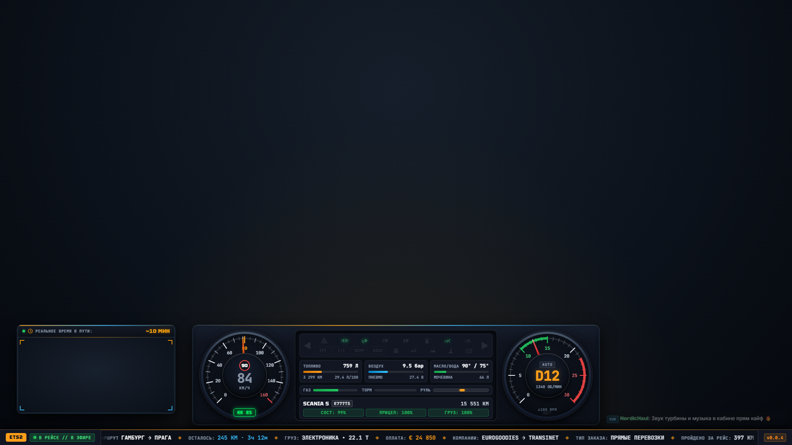
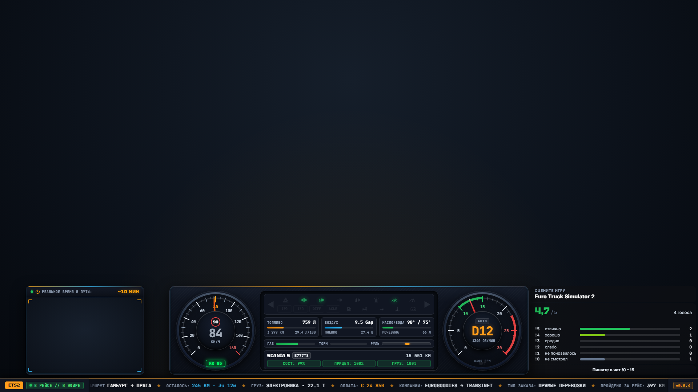

  
  <h1>ETS2 / ATS Stream Overlay Cockpit v0.0.4</h1>
  
<strong>Zero-blur 60 FPS telemetry HUD for Euro Truck Simulator 2 &amp; American Truck Simulator</strong>

  
  
  
  
  

   

  

  

    <a href="./README.md">[Main README]</a> •
    <a href="./README.ru.md">[RU] Русская версия</a> •
    <a href="./CHANGELOG.en.md">Changelog</a> •
    <a href="./commands.en.md">Chat Commands</a> •
    <a href="./RELEASE_NOTES_v0.0.4.md">Release Notes v0.0.4</a>
  

---

## Engineering Overview

Most browser overlays drop frames in OBS Studio due to GPU-heavy `backdrop-filter: blur` passes, unthrottled DOM churn, and external server dependencies. **Stream Overlay Cockpit** is engineered for `1920×1080` and `2560×1440` broadcasts at a locked **60 FPS**:

- **Native SCS SDK 1.16 Plugin (`overlayobs_foozzee_telemetry.dll`):** Captures speed, RPM, gear, air pressure, fuel, coolant/oil temperatures, pedal travel, steering angle, cargo telemetry, and real-time ETA directly from Shared Memory over a lightweight local HTTP bridge (`127.0.0.1:30002`).
- **Matte 3D-Carousel Chat (`rgba(14, 16, 20, 0.70)`):** Borderless dark-matte message pills with zero `backdrop-filter`, height-aware dynamic DOM pruning, native Twitch IRC emotes (`Array.from` Unicode code points) + **7TV / BTTV / FFZ**, real **Twitch GQL** badges, and an infinite 3D flip cycle (**Chat 5m → `!0–!5` Game Poll 1m → Chat 5m → Socials Card 1m**).
- **Game Rating Poll & 7 Chat Commands:** Captures `!0–!5` votes before `hideCommands`, computes the `1–5` rating average without `!0` distortion, prioritizes manual `chat.gameTitle` over `auto` detection, and exposes individual toggles/cooldowns for `!honk`, `!cb`, `!route`, `!stats`, `!truck`, `!driver`, and `!bet`.
- **Bilingual Setup (`RU / EN`) & Focused WPF Configurator:** Standalone `.exe` installer with live **Русский / English** switching, automatic DLL deployment, `Overlay Bridge` / `Overlay Configurator` / `Overlay Update` shortcuts, and safe `Uninstall.exe` preserving `config.js`.

---

## Visual Previews

### Cockpit HUD — 4:3 Webcam Frame (Default)

### Cockpit HUD — 16:9 Widescreen Webcam Frame (`?cam=16x9`)

### Matte 3D-Flip Game Rating Poll (`!0–!5`)

---

## Quick Start (3 Steps)

1. **Install:** Run `Stream_Overlay_Cockpit_Setup_v0.0.4.exe`, select **English**, pick your installation folder (default `C:\Stream_Overlay_Cockpit`), and verify ETS2/ATS paths for automatic `overlayobs_foozzee_telemetry.dll` deployment.
2. **Configure:** Open **`Overlay Configurator`** from your Desktop (or `Configure-Overlay.bat`) to set your Twitch channel, DonationAlerts socket token, poll `gameTitle` (`auto` or custom), social links, and chat command toggles.
3. **Add to OBS Studio:** Add a **Browser Source**, **uncheck Local file**, set URL to `file:///C:/Stream_Overlay_Cockpit/ets2-desktop.html` (or append `?cam=16x9`), Width `1920`, Height `1080`, FPS `60`. Launch **`Overlay Bridge`** before starting ETS2/ATS.

---

## URL Query Parameters

| Parameter | Description |
| :--- | :--- |
| `?cam=16x9` / `?cam=4x3` | Force webcam frame aspect ratio |
| `?theme=amber` / `?theme=ice` | Switch cockpit cluster backlight preset |
| `?view=chat` / `?view=poll` / `?view=socials` | Pin a specific 3D-carousel face |
| `?fast=1` | Accelerated 3D flip cycle (6s / 4s) for testing |
| `?test=1` / `?demo=1` | Enable telemetry demo mode and sample `!0–!5` votes |

---

## Author & Links — FooZzee

- **GitHub:** https://github.com/FooZzee/stream-overlay-cockpit
- **Website:** https://foozzee.ru
- **Twitch:** https://twitch.tv/foozzee
- **YouTube:** https://youtube.com/@foozzee
- **Telegram:** https://t.me/foozzeestream
- **VK:** https://vk.ru/gtfun
- **DonationAlerts:** https://www.donationalerts.com/r/foozzee

> Proprietary Freeware License (All Rights Reserved). Free personal use for live streams and video broadcasts; commercial resale, rebranding, or public redistribution of modified builds without written permission is prohibited. See [LICENSE](./LICENSE).

Copyright (c) 2026 FooZzee. All Rights Reserved.
