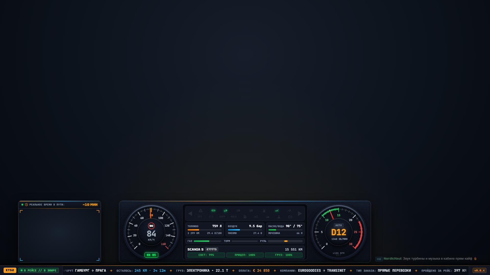

<div align="center">
  
  <h1>ETS2 / ATS Stream Overlay Cockpit</h1>
  <p><strong>Zero-Blur 60 FPS Telemetry HUD &amp; Matte 3D Chat for Euro Truck Simulator 2 and American Truck Simulator</strong></p>

  [](https://github.com/FooZzee/stream-overlay-cockpit/releases/tag/v0.0.4)
  [](https://www.microsoft.com/windows)
  [](https://modding.scssoft.com/wiki/Documentation/Engine/SDK/Telemetry)
  [](https://obsproject.com/)
  [](#architecture-en)
  [](./LICENSE)

  <br />

  [](https://www.donationalerts.com/r/foozzee)

  <p>
    <a href="./README.md">README.md</a> ·
    <a href="./README.ru.md">Русский (README.ru.md)</a> ·
    <a href="./CHANGELOG.en.md">Changelog</a> ·
    <a href="./commands.en.md">Commands &amp; API</a> ·
    <a href="./RELEASE_NOTES_v0.0.4.md">Release v0.0.4</a>
  </p>
</div>

---

## Inspiration & rTruckSim Compatibility

<table>
  <tr>
    <td width="240" align="center" valign="middle">
      <a href="https://rtrucksim.fr/" target="_blank" rel="noopener noreferrer">
        
      </a>
    </td>
    <td valign="middle">
      <p><strong>ETS2 / ATS Stream Overlay Cockpit</strong> is a standalone broadcast telemetry HUD locked at <strong>60 FPS</strong> with zero <code>backdrop-filter: blur</code>. Inspired by <a href="https://rtrucksim.fr/" target="_blank" rel="noopener noreferrer"><strong>rTruckSim</strong></a>, this project was built as the author's own zero-blur 60 FPS overlay featuring a matte 3D chat carousel, shatter stream alerts, and a native desktop toolkit.</p>
      <ul>
        <li><strong>Telemetry Specification:</strong> Telemetry data format based on rTruckSim (https://rtrucksim.fr/).</li>
        <li><strong>Plugin Isolation:</strong> <code>overlayobs_foozzee_telemetry.dll</code> operates in its own Shared Memory segment and stays fully compatible without conflicting with <code>rtrucksim_telemetry.dll</code>.</li>
      </ul>
    </td>
  </tr>
</table>

---

## Live Interface Showcase

<div align="center">
  <p><strong>16:9 Widescreen Cockpit HUD — 1920×1080 / 2560×1440 @ 60 FPS</strong></p>
  
</div>

<table>
  <tr>
    <td width="50%" align="center" valign="top">
      <strong>Universal 4:3 Webcam Frame</strong><br />
      
      <p>Cluster-height aligned camera frame (<code>325×244 px @ 1080p</code> | <code>397×298 px @ 1440p</code>) with an integrated live trip clock, smooth <code>10px</code> corner radius, and opaque <code>#0B0F17</code> gauges.</p>
    </td>
    <td width="50%" align="center" valign="top">
      <strong>Matte 3D Game Rating Poll (<code>!0–!5</code>)</strong><br />
      
      <p>Three borderless <code>rgba(14, 16, 20, 0.70)</code> blocks: captures votes before <code>hideCommands</code>, computes the <code>1–5</code> rating average without <code>!0</code> distortion, and respects manual <code>gameTitle</code>.</p>
    </td>
  </tr>
</table>

---

## Desktop Suite & Custom Icons

<table>
  <tr>
    <td width="33.3%" align="center" valign="top">
      <br />
      <strong><code>Overlay Bridge</code></strong><br />
      <sub>Local HTTP telemetry bridge (<code>127.0.0.1:30002</code>) streaming SCS SDK 1.16 Shared Memory packets to OBS with near-zero CPU overhead.</sub>
    </td>
    <td width="33.3%" align="center" valign="top">
      <br />
      <strong><code>Overlay Configurator</code></strong><br />
      <sub>Focused WPF utility for Twitch, DonationAlerts, poll <code>gameTitle</code>, 3D carousel timings, social links, and per-command cooldowns.</sub>
    </td>
    <td width="33.3%" align="center" valign="top">
      <br />
      <strong><code>Overlay Update</code></strong><br />
      <sub>GitHub release updater syncing newer builds while preserving your local <code>config.js</code> credentials and preferences.</sub>
    </td>
  </tr>
</table>

---

<a id="architecture-en"></a>
## Architecture & Performance (60 FPS Zero-Blur)

```text
ETS2 / ATS Shared Memory ─▶ overlayobs_foozzee_telemetry.dll ─▶ Local HTTP Bridge (127.0.0.1:30002) ─▶ OBS Browser Source @ 60 FPS (Zero Blur)
```

In OBS Studio's embedded Chromium engine, CSS `backdrop-filter: blur` forces full-frame offscreen compositing passes on every tick, causing frame pacing drops when combined with live telemetry and chat updates. **Stream Overlay Cockpit** eliminates blur entirely:

- **Solid Matte Surfaces:** the cockpit cluster renders over an opaque `#0B0F17` backdrop, while chat pills and 3D carousel cards use a clean `rgba(14, 16, 20, 0.70)` matte fill without borders or heavy shadows.
- **Height-Bounded DOM Pruning:** incoming messages automatically evict older nodes based on measured slot height, keeping frame times locked at 60 FPS during active chat bursts.
- **Direct Local Pipeline:** `overlayobs_foozzee_telemetry.dll` reads simulator memory directly and serves it over `127.0.0.1:30002` with no external cloud relay.

---

## Detailed Module Breakdown

### 1. Cockpit Telemetry Cluster (`Cockpit HUD`)
- **Primary Gauges:** `0–160` speedometer (`km/h` / `mph`), zone-colored tachometer, and live transmission gear indicator (`R`, `N`, `A1–A12` / `C1–C2`).
- **Truck Systems:** pneumatic air pressure, fuel level, coolant and oil temperatures, odometer, and lighting / cruise control / retarder status indicators.
- **Controls & Wear:** real-time pedal travel bars (throttle, brake, clutch), steering wheel angle indicator, and wear percentages for truck, trailer, and cargo.
- **Bottom Job Bar:** origin and destination cities, cargo name, remaining distance, live calculated **ETA**, and delivery payout.

### 2. Universal Webcam Frame (`4:3` & `16:9`)
- **Exact Dimensions:** `325×244 px` (`4:3`) and `384×216 px` (`16:9`) at `1080p`; `397×298 px` (`4:3`) and `464×261 px` (`16:9`) at `1440p`.
- **Details:** clean `10px` rounded corners, integrated live trip clock, and instant aspect ratio switching via URL query (`?cam=16x9`) or developer console.

### 3. Matte 3D Chat, Infinite Carousel & `!0–!5` Poll
- **Chat Rendering:** native Twitch IRC emotes parsed accurately via Unicode code points (`Array.from`), **7TV / BTTV / FFZ** emote support, and real **Twitch GQL** badges with clean text fallbacks.
- **Infinite 3D Carousel:** smooth `rotateY(180deg)` flip with hidden inactive face (`opacity: 0; pointer-events: none;`) running on a configurable cycle: **`5m Chat → 1m Poll (!0–!5) → 5m Chat → 1m Socials Card`**.
- **Smart `!0–!5` Poll:** votes are intercepted before `hideCommands` filtering; `!0` counts in the bar distribution without dragging down the `1–5` average score. Manual `chat.gameTitle` overrides `auto` game detection.

### 4. Interactive Twitch Chat Commands (7 Commands)

Command dispatch is handled by `ets2-chat.js`. Per-command toggles and cooldown timers are configured in **`Overlay Configurator`** (or directly in `config.js`).

| Command | Aliases | Overlay Action & Telemetry Returned |
| :--- | :--- | :--- |
| **`!honk`** | `!гудок`, `!фафа`, `!клаксон` | Plays the truck air horn sound and triggers a visual cluster response respecting cooldowns. |
| **`!cb`** | `!рация`, `!сиби` | Displays a viewer message on the in-cockpit CB radio screen. |
| **`!route`** | `!job`, `!рейс`, `!маршрут`, `!груз` | Shows current job details: origin, destination, cargo, mass, remaining distance, and payout. |
| **`!stats`** | `!стата`, `!статистика`, `!стрим` | Prints live session summary: distance driven, completed deliveries, and total earnings. |
| **`!truck`** | `!тягач`, `!автобус`, `!машина` | Displays truck make/model, active gear, cruise control state, and component wear. |
| **`!driver`** | `!водитель`, `!права`, `!рейтинг` | Shows the driver profile card with active haul status and key stats. |
| **`!bet`** | `!ставка` | Interactive trip outcome / ETA prediction command for chat viewers. |

### 5. Shatter Stream Alerts & Bilingual Setup (`RU / EN`)
- **Stream Alerts:** DonationAlerts donations, subs, follows, and raids slide smoothly from behind the cluster and finish with a particle shatter dispersion effect.
- **Installer & Configurator:** auto-sized WPF wizard (`SizeToContent.Height`) with live `Русский / English` toggle (saved to `config.js` and `InstallLanguage`), automatic `overlayobs_foozzee_telemetry.dll` deployment, and safe `Uninstall.exe` preserving `config.js` when the config removal checkbox is unchecked.

---

## Step-by-Step Installation & OBS Studio Setup

> [!IMPORTANT]
> When adding the overlay to OBS Studio, **you must uncheck "Local file"** — otherwise OBS strips URL query parameters (`?cam=16x9`, `?theme=ice`) and they will not apply.

1. **Install the Suite:**
   Run `Stream_Overlay_Cockpit_Setup_v0.0.4.exe`, select **English**, pick your destination folder (default `C:\Stream_Overlay_Cockpit`), and confirm detected ETS2 / ATS paths for `overlayobs_foozzee_telemetry.dll` installation.
2. **Configure (`Overlay Configurator`):**
   Open **`Overlay Configurator`** from your Desktop (or `Configure-Overlay.bat`) to set your Twitch channel, DonationAlerts socket token, poll `gameTitle` (`auto` or custom), social links, and command cooldowns.
3. **Add to OBS Studio:**
   - Create a new **Browser Source**.
   - **Uncheck "Local file"**.
   - Set **URL** to:
     - `4:3` webcam frame: `file:///C:/Stream_Overlay_Cockpit/ets2-desktop.html`
     - `16:9` webcam frame: `file:///C:/Stream_Overlay_Cockpit/ets2-desktop.html?cam=16x9`
   - Set dimensions to **`1920` × `1080`** (or `2560` × `1440`) and **`60` FPS**.
   - Uncheck **"Shutdown source when not visible"** so session statistics persist across scene switches.
4. **Launch Before Streaming:**
   Start **`Overlay Bridge`** from your Desktop before launching ETS2 or ATS.

---

## URL Query Parameters Reference

| Parameter | Example | Behavior |
| :--- | :--- | :--- |
| `?cam=4x3` / `?cam=16x9` | `ets2-desktop.html?cam=16x9` | Force webcam frame aspect ratio |
| `?theme=amber` / `?theme=ice` | `ets2-desktop.html?theme=ice` | Switch cockpit cluster backlight preset |
| `?view=chat` / `?view=poll` / `?view=socials` | `ets2-desktop.html?view=poll` | Pin a specific 3D-carousel face |
| `?fast=1` | `ets2-desktop.html?fast=1` | Accelerated 3D flip cycle (`6s / 4s`) for testing |
| `?test=1` / `?demo=1` | `ets2-desktop.html?test=1&demo=1` | Enable demo telemetry and sample `!0–!5` votes without the game running |
| `?lang=en` / `?lang=ru` | `ets2-desktop.html?lang=en` | Force overlay UI language |
| `?units=kmh` / `?units=mph` | `ets2-desktop.html?units=mph` | Force speed units (`km/h` or `mph`) |

---

## Troubleshooting & FAQ

- **`?cam=16x9` or `?theme=ice` is ignored in OBS:** verify that **"Local file" is unchecked** in Browser Source properties and the URL starts with `file:///`.
- **No telemetry data appears:** make sure **`Overlay Bridge`** is running and `overlayobs_foozzee_telemetry.dll` is located inside your game's `bin\win_x64\plugins` directory.
- **Will updating overwrite my Twitch or DonationAlerts tokens?** No — **`Overlay Update`** and `Uninstall.exe` (with config removal unchecked) preserve your existing `config.js`.

---

## Author — FooZzee

<p align="left">
  <a href="https://github.com/FooZzee/stream-overlay-cockpit"></a>
  <a href="https://foozzee.ru"></a>
  <a href="https://twitch.tv/foozzee"></a>
  <a href="https://youtube.com/@foozzee"></a>
  <a href="https://t.me/foozzeestream"></a>
  <a href="https://vk.ru/gtfun"></a>
  <a href="https://www.donationalerts.com/r/foozzee"></a>
</p>

> Proprietary Freeware License (All Rights Reserved). Free personal use for live streams and video broadcasts; commercial resale, rebranding, or public redistribution of modified builds without written permission is prohibited. See [LICENSE](./LICENSE).  
> Copyright (c) 2026 FooZzee. All Rights Reserved.
