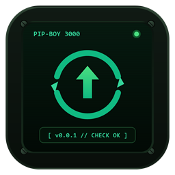
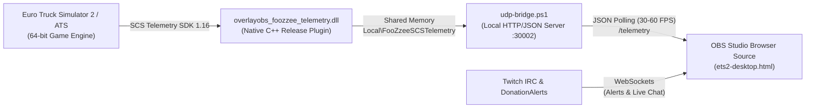

# 🚛 ETS2 / ATS Stream Overlay Cockpit v0.0.4

> **ETS2 / ATS Stream Overlay Cockpit v0.0.4**  
> Standalone Truck Cockpit HUD Stream Overlay & Native SCS SDK 1.16 Telemetry Plugin for OBS Studio.

---

## 🖼️ Visual Previews

### Standard 4:3 Webcam Frame (Default)

### Widescreen 16:9 Webcam Frame

### Desktop App Shortcuts
| Telemetry Bridge Shortcut | Auto-Updater Shortcut |
| :---: | :---: |
|  |  |

---

## 📋 System Requirements

| Component | Requirement | Notes |
| :--- | :--- | :--- |
| **Operating System** | Windows 10 / 11 (x64) | 64-bit architecture |
| **Simulators** | Euro Truck Simulator 2 / American Truck Simulator | Version 1.40+ (Steam x64) |
| **Telemetry Protocol** | SCS Telemetry SDK 1.16 | Native `overlayobs_foozzee_telemetry.dll` |
| **Streaming Software** | OBS Studio 28.0+ | Browser Source |
| **Network Stack** | Local port `30002` (HTTP) | Direct packet bridge without external servers |

---

## 🏛️ Architecture Overview

---

## ⚡ Quick Start in 3 Steps

### Step 1. Automated Installation
Launch **`Install-Overlay.bat`** (no administrative privileges required):
1. The Setup Wizard will automatically resolve your Steam, ETS2, and ATS game paths.
2. Select your webcam frame aspect ratio:
   * **`4:3`** — standard square frame (`325×244 px` @ 1080p, matching dashboard height).
   * **`16:9`** — widescreen frame (`384×216 px` @ 1080p, matching top cluster height).
3. Optionally enter your streamer nickname and Twitch channel for chat command integration.
4. Click **«INSTALL OVERLAY»**. Files will be installed to `C:\Stream_Overlay_Cockpit`, the plugin will be placed into the `bin\win_x64\plugins` folders, and Desktop shortcuts will be created.

### Step 2. Launch Telemetry Bridge Before Streaming
Before going live, start the **«ETS2-ATS Overlay Bridge»** shortcut on your Desktop (or run `Start-Overlay.bat`). This opens the high-speed local telemetry bridge streaming memory packets at up to 60 fps.

### Step 3. Add Overlay to OBS Studio
1. In OBS Studio, add a new **«Browser»** source to your scene.
2. In the "Browser" source properties, **DO NOT** check "Local file" (otherwise webcam aspect ratio query parameters will not work). Paste the file path directly into the standard **URL** field:  
   `C:\Stream_Overlay_Cockpit\ets2-desktop.html` (or with `?cam=4x3` / `?cam=16x9`).
3. Set canvas dimensions:
   * Width: **`1920`**
   * Height: **`1080`**
   * FPS: **`60`**
4. Uncheck «Shutdown source when not visible» to preserve continuous session stats across scene transitions.
5. Click **«OK»**.

> [!TIP]
> **Webcam Layer Placement in OBS:** Place your camera capture device source **below** the overlay layer in your OBS source list and position the video feed within the webcam frame area to the left of the dashboard.

---

## 🎛️ Architecture & Feature Overview

* **Central Cockpit Dashboard:** 100% opaque dark backdrop `#0B0F17`, digital & dial speedometer (0–160 km/h / mph), tachometer, active gear, live throttle/brake/steering inputs, fuel volume, air pressure, temperatures, and trip odometer.
* **Universal Webcam Frame:** `4:3` and `16:9` support with real-time trip duration clock and smooth `10px` corner radii.
* **Gaming Chat Dock:** 85% opacity dark dock on the right side, optimized for OBS Browser Source without GPU-heavy `backdrop-filter: blur`.
* **Animated Stream Alerts:** Slide-up reveal cards (+10 px above dashboard) with particle shatter explosion on dismissal.
* **Native SCS Telemetry SDK 1.16 Plugin:** Direct C++ binary capture via `overlayobs_foozzee_telemetry.dll` with zero FPS penalty.

---

## 🔧 Troubleshooting Guide

| Issue | Cause | Solution |
| :--- | :--- | :--- |
| Gauges show `0` | Telemetry bridge not running | Launch the `ETS2-ATS Overlay Bridge` shortcut before launching the game. |
| `DLL Missing` error | Game running in 32-bit mode | Launch the simulator strictly in `64-bit (DirectX 11)` mode. |
| Webcam misaligned | Aspect ratio mismatch | Add `?cam=4x3` or `?cam=16x9` to the Browser Source URL in OBS. |
| Chat commands inactive | Channel name not configured | Specify your channel name in `config.js` under `channels.twitch.channelName`. |

---

## 👤 Author & Support

* **Creator:** FooZzee
* **Website:** https://foozzee.ru
* **Twitch:** https://twitch.tv/foozzee
* **YouTube:** https://youtube.com/@foozzee
* **Telegram:** https://t.me/foozzeestream
* **VK:** https://vk.ru/gtfun
* **Support the Project:** [DonationAlerts (https://www.donationalerts.com/r/foozzee)](https://www.donationalerts.com/r/foozzee)

---

Copyright (c) 2026 FooZzee. All Rights Reserved.
