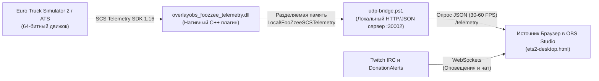

# 🚛 ETS2 / ATS Stream Overlay Cockpit v0.0.2

> **ETS2 / ATS Stream Overlay Cockpit v0.0.2**  
> Standalone Truck Cockpit HUD Stream Overlay & Native SCS SDK 1.16 Telemetry Plugin for OBS Studio.  
> Автономный оверлей приборной панели тягача и нативный плагин телеметрии SCS SDK 1.16 для OBS Studio.

---

### 🌐 Quick Language Jump / Выбор языка

[🇬🇧 English Documentation](#-english-documentation) • [🇷🇺 Русская документация](#-русская-документация) • [Changelog](./CHANGELOG.md) • [Commands](./commands.md)

*Standalone files:* [English (README.en.md)](./README.en.md) • [Русский (README.ru.md)](./README.ru.md) • [Commands (commands.md)](./commands.md) • [Commands EN (commands.en.md)](./commands.en.md) • [Справочник команд RU (commands.ru.md)](./commands.ru.md)

---

## 🇬🇧 English Documentation

**ETS2 / ATS Stream Overlay Cockpit** is an ultra-low latency, broadcast-grade telemetry HUD engineered for live streamers on Twitch, YouTube, and Kick. Featuring an opaque cockpit dashboard console, symmetrical webcam dock (`4:3` or `16:9`), modular chat dock, and animated stream alert notifications, it delivers full telemetry insight while maintaining 60 fps rendering efficiency in OBS Studio.

### 🖼️ Visual Previews

#### Standard 4:3 Webcam Frame (Default)

#### Widescreen 16:9 Webcam Frame

#### Desktop App Shortcuts
| Telemetry Bridge Shortcut | Auto-Updater Shortcut |
| :---: | :---: |
|  |  |

---

### 📋 System Requirements

| Component | Requirement | Notes |
| :--- | :--- | :--- |
| **Operating System** | Windows 10 / 11 (x64) | 64-bit architecture |
| **Simulators** | Euro Truck Simulator 2 / American Truck Simulator | Version 1.40+ (Steam x64) |
| **Telemetry Protocol** | SCS Telemetry SDK 1.16 | Native `overlayobs_foozzee_telemetry.dll` |
| **Streaming Software** | OBS Studio 28.0+ | Browser Source |
| **Network Stack** | Local port `30002` (HTTP) | Direct packet bridge without external servers |

---

### 🏛️ Architecture Overview

---

### ⚡ Quick Start in 3 Steps

#### Step 1. Automated Installation
Launch **`Install-Overlay.bat`** (no administrative privileges required):
1. The Setup Wizard will automatically resolve your Steam, ETS2, and ATS game paths.
2. Select your webcam frame aspect ratio:
   * **`4:3`** — standard square frame (`325×244 px` @ 1080p, matching dashboard height).
   * **`16:9`** — widescreen frame (`384×216 px` @ 1080p, matching top cluster height).
3. Optionally enter your streamer nickname and Twitch channel for chat command integration.
4. Click **«INSTALL OVERLAY»**. Files will be installed to `C:\Stream_Overlay_Cockpit`, the plugin will be placed into the `bin\win_x64\plugins` folders, and Desktop shortcuts will be created.

#### Step 2. Launch Telemetry Bridge Before Streaming
Before going live, start the **«ETS2-ATS Overlay Bridge»** shortcut on your Desktop (or run `Start-Overlay.bat`). This opens the high-speed local telemetry bridge streaming memory packets at up to 60 fps.

#### Step 3. Add Overlay to OBS Studio
1. In OBS Studio, add a new **«Browser»** source to your scene.
2. In the "Browser" source properties, **DO NOT** check "Local file" (otherwise webcam aspect ratio query parameters will not work). Paste the file path directly into the standard **URL** field:  
   `C:\Stream_Overlay_Cockpit\ets2-desktop.html` (or with `?cam=4x3` / `?cam=16x9`).
3. Set canvas dimensions:
   * Width: **`1920`**
   * Height: **`1080`**
   * FPS: **`60`**
4. Uncheck «Shutdown source when not visible» to preserve continuous session stats across scene transitions.
5. Click **«OK»**.

> [!TIP]
> **Webcam Layer Placement in OBS:** Place your camera capture device source **below** the overlay layer in your OBS source list and position the video feed within the webcam frame area to the left of the dashboard.

---

### 🎛️ Architecture & Feature Overview

* **Central Cockpit Dashboard:** 100% opaque dark backdrop `#0B0F17`, digital & dial speedometer (0–160 km/h / mph), tachometer, active gear, live throttle/brake/steering inputs, fuel volume, air pressure, temperatures, and trip odometer.
* **Universal Webcam Frame:** `4:3` and `16:9` support with real-time trip duration clock and smooth `10px` corner radii.
* **Gaming Chat Dock:** 85% opacity dark dock on the right side, optimized for OBS Browser Source without GPU-heavy `backdrop-filter: blur`.
* **Animated Stream Alerts:** Slide-up reveal cards (+10 px above dashboard) with particle shatter explosion on dismissal.
* **Native SCS Telemetry SDK 1.16 Plugin:** Direct C++ binary capture via `overlayobs_foozzee_telemetry.dll` with zero FPS penalty.

---

### 🔧 Troubleshooting Guide

| Issue | Cause | Solution |
| :--- | :--- | :--- |
| Gauges show `0` | Telemetry bridge not running | Launch the `ETS2-ATS Overlay Bridge` shortcut before launching the game. |
| `DLL Missing` error | Game running in 32-bit mode | Launch the simulator strictly in `64-bit (DirectX 11)` mode. |
| Webcam misaligned | Aspect ratio mismatch | Add `?cam=4x3` or `?cam=16x9` to the Browser Source URL in OBS. |
| Chat commands inactive | Channel name not configured | Specify your channel name in `config.js` under `channels.twitch.channelName`. |

---

## 🇷🇺 Русская документация

**ETS2 / ATS Stream Overlay Cockpit** — сверхбыстрый и высокоточный телеметрический HUD-оверлей, спроектированный специально для прямых трансляций симуляторов на Twitch, YouTube и Kick. Оснащён непрозрачной консолью приборной панели тягача («торпедой»), симметричной рамкой веб-камеры (`4:3` или `16:9`), игровым доком чата и анимированными стрим-оповещениями, обеспечивая стабильные 60 fps в OBS Studio.

### 🖼️ Скриншоты интерфейса

#### Стандартная рамка 4:3 (по умолчанию)

#### Широкоформатная рамка 16:9

#### Фирменные ярлыки Рабочего стола
| Мост телеметрии | Автообновление |
| :---: | :---: |
|  |  |

---

### 📋 Системные требования

| Компонент | Требование | Примечание |
| :--- | :--- | :--- |
| **Операционная система** | Windows 10 / 11 (x64) | 64-разрядная архитектура |
| **Симуляторы** | Euro Truck Simulator 2 / American Truck Simulator | Версия игры 1.40+ (Steam x64) |
| **Протокол телеметрии** | SCS Telemetry SDK 1.16 | Нативный плагин `overlayobs_foozzee_telemetry.dll` |
| **Программа для стрима** | OBS Studio 28.0+ | Источник «Браузер» (Browser Source) |
| **Сетевой стек** | Локальный порт `30002` (HTTP) | Прямой обмен пакетами без внешних серверов |

---

### 🏛️ Схема архитектуры

---

### ⚡ Быстрый старт за 3 шага

#### Шаг 1. Автоматическая установка
Запустите файл **`Install-Overlay.bat`** от имени пользователя (права администратора не требуются):
1. Мастер установки автоматически определит папки игр Steam, ETS2 и ATS.
2. Выберите подходящий формат рамки веб-камеры:
   * **`4:3`** — стандартный квадратный кадр (`325×244 px` @ 1080p, по высоте приборной панели).
   * **`16:9`** — широкоформатный кадр (`384×216 px` @ 1080p, по высоте верхнего кластера).
3. При необходимости укажите ваш никнейм стримера и Twitch-канал для интерактивных команд чата.
4. Нажмите кнопку **«УСТАНОВИТЬ ОВЕРЛЕЙ»**. Файлы будут скопированы в `C:\Stream_Overlay_Cockpit`, плагин установится в папки `bin\win_x64\plugins` обеих игр, а на Рабочем столе появятся фирменные ярлыки.

#### Шаг 2. Запуск телеметрии перед стримом
Перед началом трансляции запустите ярлык **«ETS2-ATS Overlay Bridge»** на Рабочем столе (или файл `Start-Overlay.bat`). Откроется консольный мост телеметрии, передающий данные из памяти симулятора в оверлей с частотой до 60 пакетов в секунду.

#### Шаг 3. Добавление оверлея в OBS Studio
1. В OBS Studio в списке источников вашей сцены нажмите **«+»** и выберите **«Браузер»**.
2. В настройках источника «Браузер» **НЕ ставьте** галочку «Локальный файл» (иначе не будут работать URL-параметры пропорций камеры). Вставьте путь к файлу прямо в обычное поле **URL**:  
   `C:\Stream_Overlay_Cockpit\ets2-desktop.html` (или с параметром `?cam=4x3` / `?cam=16x9`).
3. Задайте разрешение:
   * Ширина: **`1920`**
   * Высота: **`1080`**
   * Частота кадров: **`60 fps`**
4. Снимите флажок «Завершать сеанс, когда источник становится невидимым», чтобы статистика рейса не прерывалась при смене сцен.
5. Нажмите **«ОК»**.

> [!TIP]
> **Размещение веб-камеры в OBS:** Расположите источник вашей веб-камеры в списке источников **ниже** слоя оверлея и совместите его с областью рамки веб-камеры слева от приборной панели.

---

### 🎛️ Архитектура модулей оверлея

* **Центральная приборная консоль («торпеда»):** 100% непрозрачный контрастный фон `#0B0F17`, цифровой и стрелочный спидометр (0–160 км/ч / mph), тахометр, передача КПП, индикаторы педалей газа, тормоза и руля, уровень топлива, давление в пневмосистеме, температуры и одометр.
* **Универсальная рамка веб-камеры:** Поддержка форматов `4:3` и `16:9`, таймер реального времени в пути и мягкое скругление углов `10px`.
* **Док чата:** Плотная подложка 85% непрозрачности справа от приборки, оптимизированная для OBS Browser Source без использования тяжёлых функций `backdrop-filter: blur`.
* **Стрим-оповещения:** Плавный выезд карточек донатов и подписок из-под приборки (+10 px) и эффектный разлёт карточки на осколки при завершении показа.
* **Нативный плагин SCS SDK 1.16:** Модуль `overlayobs_foozzee_telemetry.dll` гарантирует прямой высокоскоростной захват без задержек и без просадки FPS.

---

### 🔧 Диагностика и решение проблем (Troubleshooting)

| Проблема | Причина | Решение |
| :--- | :--- | :--- |
| Приборы показывают `0` | Не запущен мост телеметрии | Запустите ярлык `ETS2-ATS Overlay Bridge` перед входом в игру. |
| Ошибка `DLL Missing` | Игра запущена в 32-битном режиме | Запускайте симулятор строго в режиме `64-bit (DirectX 11)`. |
| Веб-камера смещена | Выбран несоответствующий формат | В параметрах URL источника добавьте `?cam=4x3` или `?cam=16x9`. |
| Чат не читает сообщения | Не указан Twitch-канал | В `config.js` в поле `channels.twitch.channelName` укажите логин канала. |

---

### 👤 Автор проекта и контакты / Author & Credits — FooZzee

* **Автор:** FooZzee
* **Сайт:** https://foozzee.ru
* **Twitch:** https://twitch.tv/foozzee
* **YouTube:** https://youtube.com/@foozzee
* **Telegram:** https://t.me/foozzeestream
* **VK:** https://vk.ru/gtfun
* **Поддержать разработку:** [DonationAlerts (https://www.donationalerts.com/r/foozzee)](https://www.donationalerts.com/r/foozzee)

---

Copyright (c) 2026 FooZzee. All Rights Reserved.
