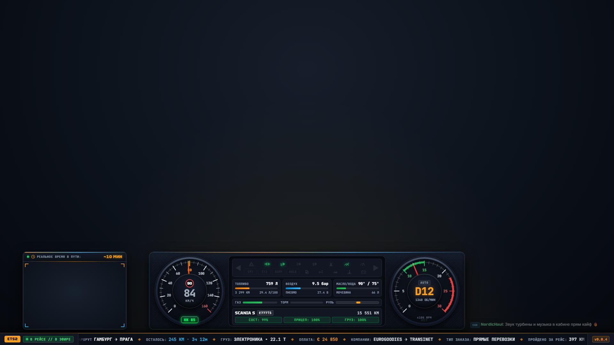
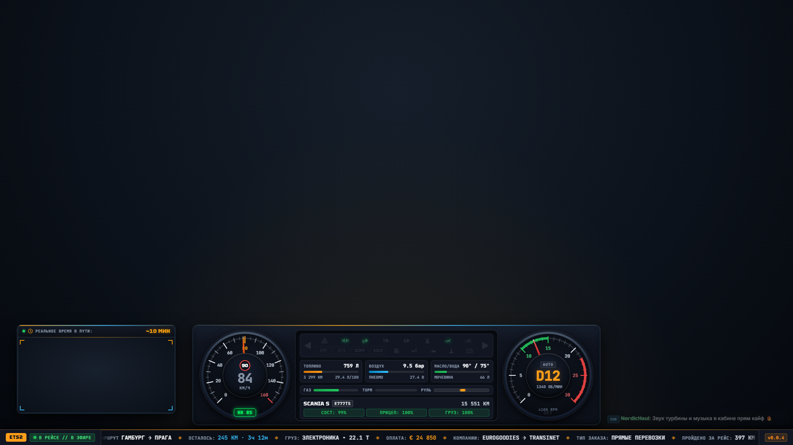

  
  <h1>ETS2 / ATS Stream Overlay Cockpit v0.0.4</h1>
  
<strong>Zero-blur 60 FPS broadcast HUD for Euro Truck Simulator 2 &amp; American Truck Simulator</strong>

  
  
  
  
  

   

  
  

  

    <a href="./README.en.md">[EN] English Documentation</a> •
    <a href="./README.ru.md">[RU] Русская документация</a> •
    <a href="./CHANGELOG.md">Changelog</a> •
    <a href="./commands.md">Chat Commands</a> •
    <a href="./RELEASE_NOTES_v0.0.4.md">Release Notes v0.0.4</a>
  

---

## Why This Overlay Exists

Standard web overlays drop frames in OBS Studio because of heavy `backdrop-filter: blur` shaders, polling bloat, and unoptimized DOM updates. **Stream Overlay Cockpit** is built as a pure broadcast instrument cluster for `1920×1080` and `2560×1440` at locked **60 FPS**:

- **Native SCS SDK 1.16 Telemetry (`overlayobs_foozzee_telemetry.dll`):** Reads speed, RPM, gear, air pressure, fuel, temperatures, pedals, steering angle, cargo, and ETA directly from Shared Memory via a local HTTP bridge (`127.0.0.1:30002`) with zero in-game FPS hit.
- **Matte 3D-Carousel Chat (`rgba(14, 16, 20, 0.70)`):** Borderless dark-matte message pills with dynamic height-based pruning, native Twitch IRC emotes (`Array.from` Unicode code points) + **7TV / BTTV / FFZ**, real **Twitch GQL** badges, and an infinite 3D flip cycle (**Chat 5m → `!0–!5` Game Poll 1m → Chat 5m → Socials Card 1m**).
- **7 Interactive Chat Commands:** `!гудок` (`!honk`), `!рация` (`!cb`), `!рейс` (`!route`), `!стата` (`!stats`), `!тягач` (`!truck`), `!водитель` (`!driver`), `!ставка` (`!bet`) — each toggleable with role gates and per-user cooldowns.
- **Bilingual Setup (`RU / EN`) & Focused WPF Configurator:** One-click `.exe` installer with `Русский / English` language switcher, automatic ETS2/ATS plugin deployment, `Overlay Bridge` / `Overlay Configurator` / `Overlay Update` desktop shortcuts, and safe `Uninstall.exe` preserving `config.js`.

---

## Visual Previews

### Cockpit HUD — 4:3 Webcam Frame (Default)

### Cockpit HUD — 16:9 Widescreen Webcam Frame

### Matte 3D-Flip Game Rating Poll (`!0–!5`)

---

## Quick Start (3 Steps)

1. **Install:** Run `Stream_Overlay_Cockpit_Setup_v0.0.4.exe` (select **Русский** or **English**, choose target folder e.g. `C:\Stream_Overlay_Cockpit`, and confirm ETS2/ATS plugin paths).
2. **Configure:** Launch **`Overlay Configurator`** from your Desktop (or `Configure-Overlay.bat`) to set your Twitch channel, DonationAlerts token, poll `gameTitle` (`auto` or custom), social links, and chat commands.
3. **Add to OBS Studio:** Create a **Browser Source**, uncheck **Local file**, set URL to `file:///C:/Stream_Overlay_Cockpit/ets2-desktop.html` (or `?cam=16x9`), Width `1920`, Height `1080`, FPS `60`. Start **`Overlay Bridge`** before launching ETS2/ATS.

---

## Author & Links — FooZzee

- **GitHub:** https://github.com/FooZzee/stream-overlay-cockpit
- **Website:** https://foozzee.ru
- **Twitch:** https://twitch.tv/foozzee
- **YouTube:** https://youtube.com/@foozzee
- **Telegram:** https://t.me/foozzeestream
- **VK:** https://vk.ru/gtfun
- **DonationAlerts:** https://www.donationalerts.com/r/foozzee

> Proprietary Freeware License (All Rights Reserved). Free personal use for live streams and video broadcasts; commercial resale, rebranding, or public redistribution of modified builds without written permission is prohibited. See [LICENSE](./LICENSE).

Copyright (c) 2026 FooZzee. All Rights Reserved.
