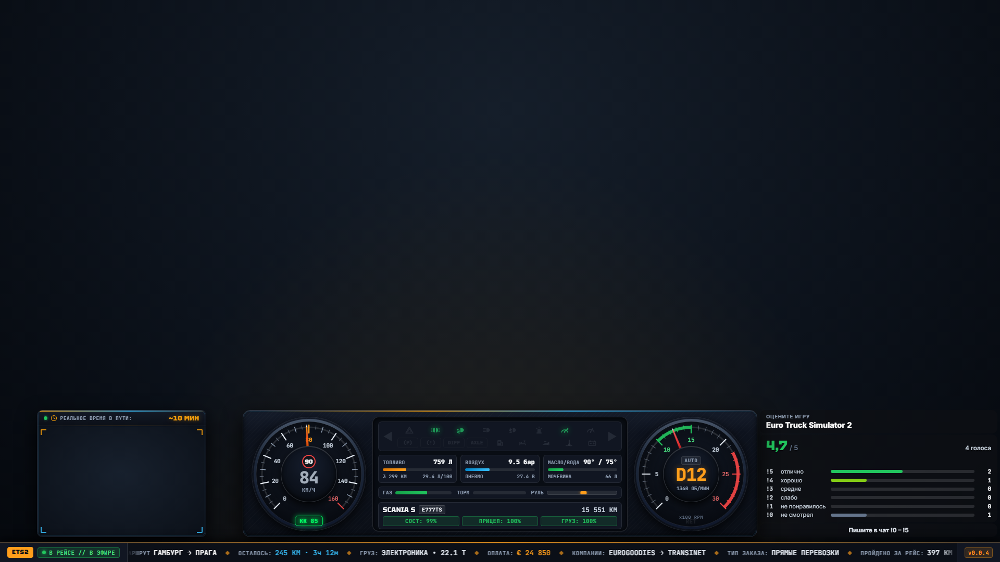

<div align="center">
  
  <h1>ETS2 / ATS Stream Overlay Cockpit</h1>
  <p><strong>60 FPS Zero-Blur Telemetry HUD &amp; Matte 3D Chat for Euro Truck Simulator 2 and American Truck Simulator</strong></p>

  [](https://github.com/FooZzee/stream-overlay-cockpit/releases/tag/v0.0.4)
  [](https://www.microsoft.com/windows)
  [](https://modding.scssoft.com/wiki/Documentation/Engine/SDK/Telemetry)
  [](https://obsproject.com/)
  [](#architecture)
  [](./LICENSE)

  <br />

  [](https://www.donationalerts.com/r/foozzee)

  <p>
    <a href="./README.ru.md">README.ru.md</a> ·
    <a href="./README.en.md">README.en.md</a> ·
    <a href="./CHANGELOG.md">CHANGELOG</a> ·
    <a href="./commands.md">Commands</a> ·
    <a href="./RELEASE_NOTES_v0.0.4.md">Release v0.0.4</a>
  </p>
</div>

---

## Live Interface Showcase / Посмотрите в деле

<div align="center">
  <p><strong>16:9 Widescreen Cockpit HUD — 1920×1080 / 2560×1440 @ 60 FPS</strong></p>
  
</div>

<table>
  <tr>
    <td width="50%" align="center" valign="top">
      <strong>4:3 Standard Webcam Frame</strong><br />
      
      <p>Symmetrical cluster-height frame (<code>325×244 px @ 1080p</code> | <code>397×298 px @ 1440p</code>) with live trip duration clock and 100% opaque <code>#0B0F17</code> gauges.</p>
    </td>
    <td width="50%" align="center" valign="top">
      <strong>Matte 3D Game Poll (<code>!0–!5</code>)</strong><br />
      
      <p>Borderless <code>rgba(14, 16, 20, 0.70)</code> 3D-carousel face: captures votes before <code>hideCommands</code>, computes <code>1–5</code> rating excluding <code>!0</code>, and respects manual <code>gameTitle</code>.</p>
    </td>
  </tr>
</table>

---

## Desktop Suite & Custom Icons / Десктопный пакет и иконки

<table>
  <tr>
    <td width="33.3%" align="center" valign="top">
      <br />
      <strong><code>Overlay Bridge</code></strong><br />
      <sub>Local HTTP telemetry bridge (<code>127.0.0.1:30002</code>) reading SCS SDK 1.16 Shared Memory at low CPU cost.</sub>
    </td>
    <td width="33.3%" align="center" valign="top">
      <br />
      <strong><code>Overlay Configurator</code></strong><br />
      <sub>Focused WPF GUI for Twitch, DonationAlerts, 3D-poll <code>gameTitle</code>, socials, and all 7 chat commands.</sub>
    </td>
    <td width="33.3%" align="center" valign="top">
      <br />
      <strong><code>Overlay Update</code></strong><br />
      <sub>Release updater syncing new builds from GitHub while preserving user <code>config.js</code> tokens and settings.</sub>
    </td>
  </tr>
</table>

---

<a id="architecture"></a>
## Architecture Pipeline / Архитектура

```text
ETS2 / ATS Shared Memory ─▶ overlayobs_foozzee_telemetry.dll ─▶ Local HTTP Bridge (127.0.0.1:30002) ─▶ OBS Browser Source @ 60 FPS (Zero Blur)
```

---

## Русский · [Полная документация (README.ru.md)](./README.ru.md)

**Stream Overlay Cockpit** — лёгкий HUD для прямых трансляций ETS2 и ATS в OBS Studio (`1920×1080` и `2560×1440`) без просадок кадров: в вёрстке полностью исключён GPU-тяжёлый `backdrop-filter: blur`, а телеметрия поступает напрямую из памяти игры.

| Модуль | Инженерная реализация |
| :--- | :--- |
| **Телеметрия кабины** | Спидометр `0–160` (`km/h` / `mph`), тахометр, передача КПП, воздух, топливо, температуры, педали, угол руля, износ и живой ETA |
| **Матовый 3D-чат и карусель** | Плашки `rgba(14, 16, 20, 0.70)` без обводок, очистка по высоте слота, нативные смайлы Twitch + **7TV/BTTV/FFZ**, бейджи **Twitch GQL**, цикл `5m Chat -> 1m Poll -> 5m Chat -> 1m Socials` |
| **7 команд чата** | `!гудок` (пневмосигнал), `!рация` (CB-сообщение), `!рейс` (маршрут), `!стата` (статистика стрима), `!тягач` (грузовик), `!водитель` (карточка пилота), `!ставка` (ставка на рейс) |
| **Установщик `RU / EN`** | Автовысота окна (`SizeToContent.Height`), переключение языка с записью в `config.js` и реестр, автоустановка DLL, 3 ярлыка и безопасный `Uninstall.exe` без `/s /q` |

### Быстрый старт (3 шага)
1. Запустите `Stream_Overlay_Cockpit_Setup_v0.0.4.exe`, выберите **Русский** и подтвердите пути к ETS2/ATS.
2. Откройте **`Overlay Configurator`** на Рабочем столе: впишите канал Twitch, токен DonationAlerts, `gameTitle` (`auto` или вручную), ссылки соцсетей и нужные команды.
3. В OBS Studio добавьте **«Браузер»**, снимите галочку **«Локальный файл»**, укажите `file:///C:/Stream_Overlay_Cockpit/ets2-desktop.html` (`1920×1080`, `60 FPS`) и запустите **`Overlay Bridge`** перед стартом игры.

---

## English · [Full Documentation (README.en.md)](./README.en.md)

**Stream Overlay Cockpit** is a broadcast-grade HUD for ETS2 and ATS engineered to stay locked at **60 FPS** in OBS Studio (`1920×1080` and `2560×1440`): zero `backdrop-filter: blur` passes, direct Shared Memory telemetry, and height-bounded DOM rendering.

| Subsystem | Implementation Details |
| :--- | :--- |
| **Cockpit Telemetry** | Speedometer `0–160` (`km/h` / `mph`), tachometer, gear indicator, air pressure, fuel, coolant/oil temps, pedals, steering angle, wear, and live ETA |
| **Matte 3D Chat & Carousel** | Borderless `rgba(14, 16, 20, 0.70)` pills, height-aware pruning, native Twitch emotes (`Array.from`) + **7TV/BTTV/FFZ**, real **Twitch GQL** badges, `5m Chat -> 1m Poll -> 5m Chat -> 1m Socials` cycle |
| **7 Chat Commands** | `!honk` (air horn), `!cb` (CB radio message), `!route` (current job), `!stats` (session stats), `!truck` (vehicle spec), `!driver` (driver card), `!bet` (trip prediction) |
| **Bilingual Setup (`RU / EN`)** | Auto-sized WPF wizard (`SizeToContent.Height`), live language switch persisted to `config.js` & registry, auto DLL deployment, 3 desktop shortcuts, and safe `Uninstall.exe` |

### Quick Start (3 Steps)
1. Run `Stream_Overlay_Cockpit_Setup_v0.0.4.exe`, select **English**, and verify ETS2/ATS installation paths.
2. Open **`Overlay Configurator`** from your Desktop to configure Twitch, DonationAlerts, poll `gameTitle` (`auto` or custom), social links, and command toggles.
3. In OBS Studio, add a **Browser Source**, **uncheck Local file**, set URL to `file:///C:/Stream_Overlay_Cockpit/ets2-desktop.html` (`1920×1080`, `60 FPS`), and launch **`Overlay Bridge`** before starting the sim.

---

## Author — FooZzee

<p align="left">
  <a href="https://github.com/FooZzee/stream-overlay-cockpit"></a>
  <a href="https://foozzee.ru"></a>
  <a href="https://twitch.tv/foozzee"></a>
  <a href="https://youtube.com/@foozzee"></a>
  <a href="https://t.me/foozzeestream"></a>
  <a href="https://vk.ru/gtfun"></a>
  <a href="https://www.donationalerts.com/r/foozzee"></a>
</p>

> Proprietary Freeware License (All Rights Reserved). See [LICENSE](./LICENSE).  
> Copyright (c) 2026 FooZzee. All Rights Reserved.
