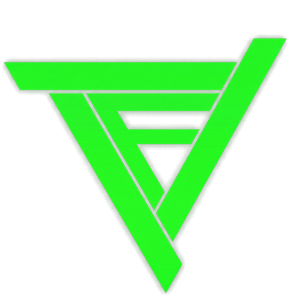
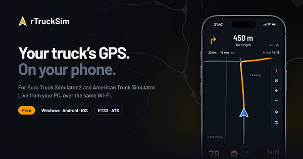
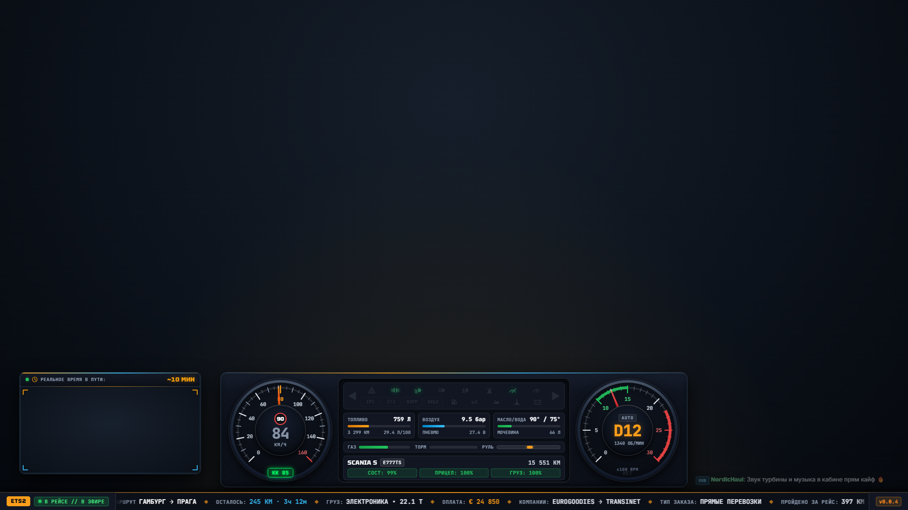
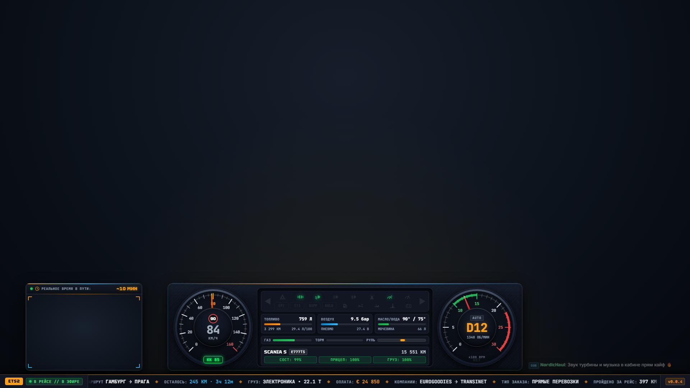
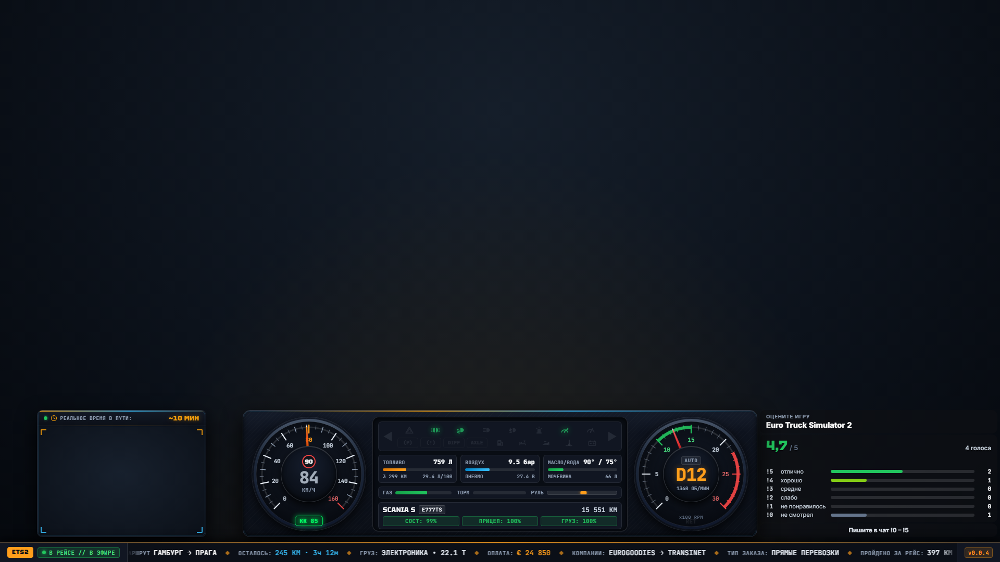

<div align="center">
  
  <h1>ETS2 / ATS Stream Overlay Cockpit</h1>
  <p><strong>Телеметрический HUD-оверлей для Euro Truck Simulator 2 и American Truck Simulator (60 FPS без blur)</strong></p>

  [](https://github.com/FooZzee/stream-overlay-cockpit/releases/tag/v0.0.4)
  [](https://www.microsoft.com/windows)
  [](https://modding.scssoft.com/wiki/Documentation/Engine/SDK/Telemetry)
  [](https://obsproject.com/)
  [](#architecture-ru)
  [](./LICENSE)

  <br />

  [](https://www.donationalerts.com/r/foozzee)

  <p>
    <a href="./README.md">README.md</a> ·
    <a href="./README.en.md">English (README.en.md)</a> ·
    <a href="./CHANGELOG.ru.md">История изменений</a> ·
    <a href="./commands.ru.md">Команды и API</a> ·
    <a href="./RELEASE_NOTES_v0.0.4.md">Релиз v0.0.4</a>
  </p>
</div>

---

## Вдохновение и совместимость с rTruckSim

<table>
  <tr>
    <td width="240" align="center" valign="middle">
      <a href="https://rtrucksim.fr/" target="_blank" rel="noopener noreferrer">
        
      </a>
    </td>
    <td valign="middle">
      <p><strong>ETS2 / ATS Stream Overlay Cockpit</strong> — автономный телеметрический HUD для прямых трансляций на стабильных <strong>60 FPS</strong>. Автор вдохновился проектом <a href="https://rtrucksim.fr/" target="_blank" rel="noopener noreferrer"><strong>rTruckSim</strong></a> и решил создать собственный независимый оверлей для стримов с матовым 3D-чатом, анимированными алертами и нативным десктопным пакетом.</p>
      <ul>
        <li><strong>Спецификация данных:</strong> Формат данных телеметрии основан на rTruckSim (https://rtrucksim.fr/) / Telemetry data format based on rTruckSim (https://rtrucksim.fr/).</li>
        <li><strong>Изоляция плагина:</strong> <code>overlayobs_foozzee_telemetry.dll</code> использует собственный сегмент Shared Memory и работает полностью совместимо без конфликта с <code>rtrucksim_telemetry.dll</code>.</li>
      </ul>
    </td>
  </tr>
</table>

---

## Галерея интерфейса

<div align="center">
  <p><strong>Широкоформатный режим 16:9 — 1920×1080 / 2560×1440 @ 60 FPS</strong></p>
  
</div>

<table>
  <tr>
    <td width="50%" align="center" valign="top">
      <strong>Универсальная рамка веб-камеры 4:3</strong><br />
      
      <p>Симметричная подгонка по высоте приборки (<code>325×244 px @ 1080p</code> | <code>397×298 px @ 1440p</code>), встроенный таймер рейса, мягкое скругление <code>10px</code> и плотная подложка <code>#0B0F17</code>.</p>
    </td>
    <td width="50%" align="center" valign="top">
      <strong>Матовый 3D-опросник игры (<code>!0–!5</code>)</strong><br />
      
      <p>Три матовых блока <code>rgba(14, 16, 20, 0.70)</code> без обводок и теней: перехват голосов до <code>hideCommands</code>, расчёт среднего по <code>1–5</code> без искажения от <code>!0</code> и приоритет ручного <code>gameTitle</code>.</p>
    </td>
  </tr>
</table>

---

## Десктопный пакет и фирменные иконки

<table>
  <tr>
    <td width="33.3%" align="center" valign="top">
      <br />
      <strong><code>Overlay Bridge</code></strong><br />
      <sub>Локальный HTTP-мост (<code>127.0.0.1:30002</code>): читает пакеты SCS SDK 1.16 Shared Memory и отдаёт телеметрию в OBS с минимальной нагрузкой на CPU.</sub>
    </td>
    <td width="33.3%" align="center" valign="top">
      <br />
      <strong><code>Overlay Configurator</code></strong><br />
      <sub>WPF-конфигуратор для настройки канала Twitch, токена DonationAlerts, <code>gameTitle</code>, таймингов 3D-карусели, соцсетей и кулдаунов 7 команд.</sub>
    </td>
    <td width="33.3%" align="center" valign="top">
      <br />
      <strong><code>Overlay Update</code></strong><br />
      <sub>Менеджер обновлений с GitHub: загружает новые версии сборок, сохраняя ваш <code>config.js</code>, ключи и пользовательские параметры.</sub>
    </td>
  </tr>
</table>

---

<a id="architecture-ru"></a>
## Архитектура и производительность (60 FPS Zero-Blur)

```text
ETS2 / ATS Shared Memory ─▶ overlayobs_foozzee_telemetry.dll ─▶ Local HTTP Bridge (127.0.0.1:30002) ─▶ OBS Browser Source @ 60 FPS (Zero Blur)
```

В движке Chromium внутри OBS Studio фильтры размытия (`backdrop-filter: blur`) вызывают повторный проход композитинга экрана на каждом кадре, что при активном чате и телеметрии провоцирует микрофризы. В **Stream Overlay Cockpit** размытие исключено полностью:

- **Плотные матовые поверхности:** приборная панель использует непрозрачный фон `#0B0F17`, а карточки чата и 3D-карусели — полупрозрачную матовую заливку `rgba(14, 16, 20, 0.70)` без размытия и тяжёлых теней.
- **Контроль DOM-дерева:** чат динамически удаляет старые сообщения строго по реальной высоте слота, удерживая время рендера в пределах 60 FPS даже при высоком потоке сообщений.
- **Прямой канал данных:** `overlayobs_foozzee_telemetry.dll` транслирует память симулятора напрямую через локальный мост `127.0.0.1:30002` без промежуточных облачных сервисов.

---

## Подробный разбор модулей оверлея

### 1. Приборная панель (`Cockpit HUD`)
- **Основные шкалы:** спидометр `0–160` с авто-переключением или принудительным выбором `km/h` / `mph`, тахометр с цветовыми зонами оборотов и индикатор текущей передачи КПП (`R`, `N`, `A1–A12` / `C1–C2`).
- **Системы тягача:** давление в пневмосистеме, уровень топлива, температуры охлаждающей жидкости и масла, одометр и индикация состояния светотехники / круиз-контроля / ретардера.
- **Управление и износ:** живые полосы хода педалей (газ, тормоз, сцепление), индикатор угла поворота рулевого колеса и процент износа тягача, прицепа и груза.
- **Нижняя строка рейса:** пункт отправления и назначения, наименование груза, оставшееся расстояние, живой расчёт **ETA** и сумма оплаты за доставку.

### 2. Универсальная рамка веб-камеры (`4:3` и `16:9`)
- **Точная геометрия:** `325×244 px` (`4:3`) и `384×216 px` (`16:9`) при разрешении сцены `1080p`; `397×298 px` (`4:3`) и `464×261 px` (`16:9`) при `1440p`.
- **Детали:** мягкое скругление углов `10px`, встроенный таймер активного рейса и мгновенное переключение пропорций через URL-параметр (`?cam=16x9`) или консоль.

### 3. Матовый 3D-чат, бесконечная карусель и опросник `!0–!5`
- **Рендеринг чата:** поддержка нативных смайлов Twitch через точный разбор суррогатных пар (`Array.from`), интеграция **7TV / BTTV / FFZ** и реальные значки **Twitch GQL** с текстовым фолбэком.
- **Бесконечная 3D-карусель:** плавный переворот по оси Y (`rotateY(180deg)`) со скрытием неактивной грани (`opacity: 0; pointer-events: none;`) по настраиваемому циклу: **`Чат 5 мин → Опросник !0–!5 1 мин → Чат 5 мин → Карточка соцсетей «Не забудь подписаться:» 1 мин`**.
- **Умный опросник (`!0–!5`):** голоса перехватываются до фильтра `hideCommands`, оценка `!0` учитывается в шкале распределения, но не занижает среднее арифметическое по оценкам `1–5`. В заголовке опросника ручной `chat.gameTitle` имеет приоритет над `auto`-определением.

### 4. Интерактивные команды Twitch-чата (7 команд)

Обработкой команд управляет модуль `ets2-chat.js`. Пользовательские кулдауны и включение/отключение отдельных триггеров задаются в **`Overlay Configurator`** (или напрямую в `config.js`).

| Команда | Алиасы | Действие в оверлее и возвращаемые данные |
| :--- | :--- | :--- |
| **`!гудок`** | `!фафа`, `!клаксон`, `!honk` | Воспроизводит пневмосигнал тягача и запускает визуальный отклик на панели с учётом кулдауна. |
| **`!рация`** | `!сиби`, `!cb` | Выводит текстовое сообщение зрителя на CB-экран радиостанции в стиле дальнобойной рации. |
| **`!рейс`** | `!маршрут`, `!груз`, `!job`, `!route` | Показывает текущий маршрут: город отправления/назначения, груз, массу, остаток дистанции и оплату. |
| **`!стата`** | `!статистика`, `!стрим`, `!stats` | Сводка текущей сессии стрима: пройденная дистанция, выполненные заказы и заработок. |
| **`!тягач`** | `!автобус`, `!машина`, `!truck` | Марка и модель тягача, текущая передача, круиз-контроль и процент износа узлов. |
| **`!водитель`** | `!права`, `!рейтинг`, `!driver` | Карточка водителя с профилем, статусом рейса и ключевыми показателями. |
| **`!ставка`** | `!bet` | Интерактивный прогноз времени/исхода текущего рейса для зрителей в чате. |

### 5. Анимированные стрим-алерты и двуязычный установщик (`RU / EN`)
- **Стрим-алерты:** уведомления о донатах (DonationAlerts), подписках, фолловах и рейдах плавно выезжают из-под приборной панели и завершаются анимацией разлёта на частицы.
- **Установщик и конфигуратор:** WPF-окно с автоподбором высоты (`SizeToContent.Height`), переключением `Русский / English` (запись в `config.js` и `InstallLanguage`), автоустановкой `overlayobs_foozzee_telemetry.dll` в ETS2/ATS и безопасным деинсталлятором `Uninstall.exe`, который сохраняет ваш `config.js` при снятой галочке удаления.

---

## Пошаговая установка и настройка в OBS Studio

> [!IMPORTANT]
> При добавлении оверлея в OBS Studio **обязательно снимите галочку «Локальный файл» (Local file)** — иначе OBS отбросит URL-параметры (`?cam=16x9`, `?theme=ice`) и они не сработают.

1. **Установка пакета:**
   Запустите `Stream_Overlay_Cockpit_Setup_v0.0.4.exe`, выберите язык **Русский**, укажите целевую директорию (по умолчанию `C:\Stream_Overlay_Cockpit`) и подтвердите найденные пути к ETS2 / ATS для установки `overlayobs_foozzee_telemetry.dll`.
2. **Конфигурация (`Overlay Configurator`):**
   Откройте ярлык **`Overlay Configurator`** на Рабочем столе (или `Configure-Overlay.bat`). Укажите канал Twitch, токен DonationAlerts, `gameTitle` (`auto` или название игры вручную), ссылки на соцсети и нужные кулдауны команд.
3. **Добавление в OBS Studio:**
   - Создайте источник **«Браузер» (Browser Source)**.
   - **Снимите галочку «Локальный файл»**.
   - В поле **URL** вставьте:
     - для камеры 4:3: `file:///C:/Stream_Overlay_Cockpit/ets2-desktop.html`
     - для камеры 16:9: `file:///C:/Stream_Overlay_Cockpit/ets2-desktop.html?cam=16x9`
   - Задайте разрешение **`1920` × `1080`** (или `2560` × `1440`) и частоту **`60` FPS**.
   - Снимите флажок **«Отключать, когда источник не видим»**, чтобы статистика стрима не сбрасывалась при смене сцен.
4. **Запуск перед стримом:**
   Перед запуском ETS2 или ATS запустите ярлык **`Overlay Bridge`** на Рабочем столе.

---

## Справочник URL-параметров

| Параметр | Пример | Назначение |
| :--- | :--- | :--- |
| `?cam=4x3` / `?cam=16x9` | `ets2-desktop.html?cam=16x9` | Принудительное переключение пропорций рамки веб-камеры |
| `?theme=amber` / `?theme=ice` | `ets2-desktop.html?theme=ice` | Переключение цветовой схемы подсветки приборки |
| `?view=chat` / `?view=poll` / `?view=socials` | `ets2-desktop.html?view=poll` | Фиксация конкретной грани 3D-карусели без автопереворота |
| `?fast=1` | `ets2-desktop.html?fast=1` | Ускоренный цикл 3D-карусели (`6с / 4с`) для быстрой проверки |
| `?test=1` / `?demo=1` | `ets2-desktop.html?test=1&demo=1` | Тестовая телеметрия и демонстрационные голоса `!0–!5` без запущенной игры |
| `?lang=ru` / `?lang=en` | `ets2-desktop.html?lang=ru` | Принудительный выбор языка интерфейса оверлея |
| `?units=kmh` / `?units=mph` | `ets2-desktop.html?units=mph` | Принудительный выбор единиц скорости (`km/h` или `mph`) |

---

## Частые вопросы (Troubleshooting)

- **Не работает параметр `?cam=16x9` или `?theme=ice` в OBS:** проверьте, что в свойствах источника «Браузер» **снята галочка «Локальный файл»** и адрес начинается с `file:///`.
- **Нет данных телеметрии в оверлее:** убедитесь, что запущен **`Overlay Bridge`**, а файл `overlayobs_foozzee_telemetry.dll` присутствует в папке `bin\win_x64\plugins` внутри директории ETS2 / ATS.
- **При обновлении сотрутся ли мои токены Twitch и DonationAlerts?** Нет — **`Overlay Update`** и `Uninstall.exe` (при снятой галочке удаления конфигурации) сохраняют ваш локальный `config.js`.

---

## Автор проекта — FooZzee

<p align="left">
  <a href="https://github.com/FooZzee/stream-overlay-cockpit"></a>
  <a href="https://foozzee.ru"></a>
  <a href="https://twitch.tv/foozzee"></a>
  <a href="https://youtube.com/@foozzee"></a>
  <a href="https://t.me/foozzeestream"></a>
  <a href="https://vk.ru/gtfun"></a>
  <a href="https://www.donationalerts.com/r/foozzee"></a>
</p>

> Лицензия: Proprietary Freeware License (All Rights Reserved). Бесплатное личное использование на стримах и в видеороликах разрешено; коммерческая перепродажа, выдача за свой продукт и публикация модифицированных сборок без письменного разрешения автора запрещены. Подробнее: [LICENSE](./LICENSE).  
> Copyright (c) 2026 FooZzee. All Rights Reserved.
