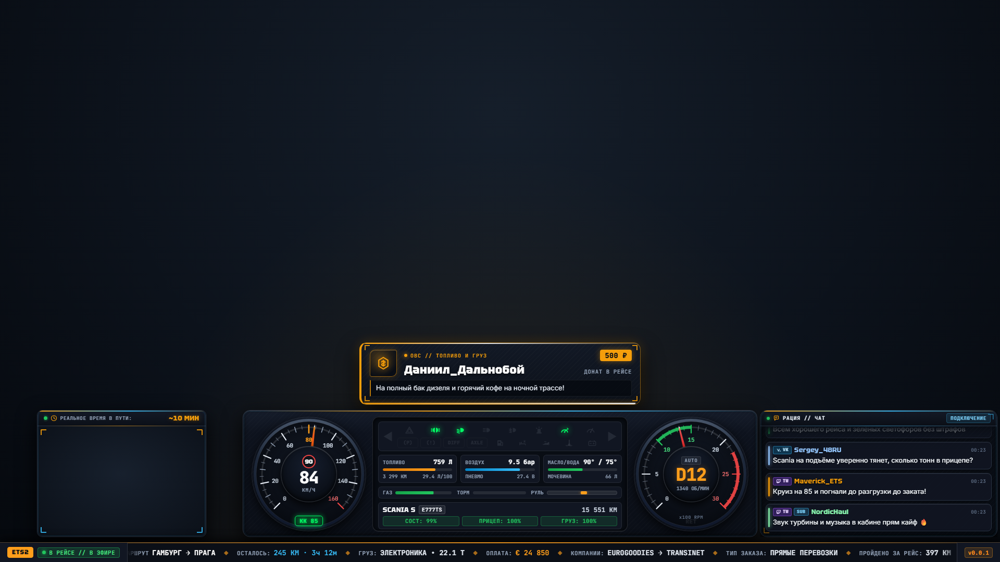
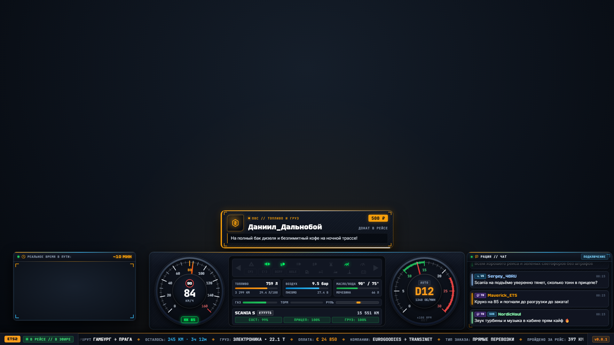
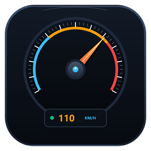
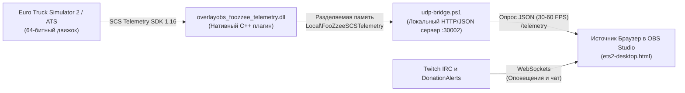

# 🚛 ETS2 / ATS Stream Overlay Cockpit v0.0.2

> **ETS2 / ATS Stream Overlay Cockpit v0.0.2**  
> Автономный оверлей приборной панели тягача и нативный плагин телеметрии SCS SDK 1.16 для OBS Studio.

---

## 🖼️ Скриншоты интерфейса

### Стандартная рамка 4:3 (по умолчанию)

### Широкоформатная рамка 16:9

### Фирменные ярлыки Рабочего стола
| Мост телеметрии | Автообновление |
| :---: | :---: |
|  |  |

---

## 📋 Системные требования

| Компонент | Требование | Примечание |
| :--- | :--- | :--- |
| **Операционная система** | Windows 10 / 11 (x64) | 64-разрядная архитектура |
| **Симуляторы** | Euro Truck Simulator 2 / American Truck Simulator | Версия игры 1.40+ (Steam x64) |
| **Протокол телеметрии** | SCS Telemetry SDK 1.16 | Нативный плагин `overlayobs_foozzee_telemetry.dll` |
| **Программа для стрима** | OBS Studio 28.0+ | Источник «Браузер» (Browser Source) |
| **Сетевой стек** | Локальный порт `30002` (HTTP) | Прямой обмен пакетами без внешних серверов |

---

## 🏛️ Схема архитектуры

---

## ⚡ Быстрый старт за 3 шага

### Шаг 1. Автоматическая установка
Запустите файл **`Install-Overlay.bat`** от имени пользователя (права администратора не требуются):
1. Мастер установки автоматически определит папки игр Steam, ETS2 и ATS.
2. Выберите подходящий формат рамки веб-камеры:
   * **`4:3`** — стандартный квадратный кадр (`325×244 px` @ 1080p, по высоте приборной панели).
   * **`16:9`** — широкоформатный кадр (`384×216 px` @ 1080p, по высоте верхнего кластера).
3. При необходимости укажите ваш никнейм стримера и Twitch-канал для интерактивных команд чата.
4. Нажмите кнопку **«УСТАНОВИТЬ ОВЕРЛЕЙ»**. Файлы будут скопированы в `C:\Stream_Overlay_Cockpit`, плагин установится в папки `bin\win_x64\plugins` обеих игр, а на Рабочем столе появятся фирменные ярлыки.

### Шаг 2. Запуск телеметрии перед стримом
Перед началом трансляции запустите ярлык **«ETS2-ATS Overlay Bridge»** на Рабочем столе (или файл `Start-Overlay.bat`). Откроется консольный мост телеметрии, передающий данные из памяти симулятора в оверлей с частотой до 60 пакетов в секунду.

### Шаг 3. Добавление оверлея в OBS Studio
1. В OBS Studio в списке источников вашей сцены нажмите **«+»** и выберите **«Браузер»**.
2. В настройках источника «Браузер» **НЕ ставьте** галочку «Локальный файл» (иначе не будут работать URL-параметры пропорций камеры). Вставьте путь к файлу прямо в обычное поле **URL**:  
   `C:\Stream_Overlay_Cockpit\ets2-desktop.html` (или с параметром `?cam=4x3` / `?cam=16x9`).
3. Задайте разрешение:
   * Ширина: **`1920`**
   * Высота: **`1080`**
   * Частота кадров: **`60 fps`**
4. Снимите флажок «Завершать сеанс, когда источник становится невидимым», чтобы статистика рейса не прерывалась при смене сцен.
5. Нажмите **«ОК»**.

> [!TIP]
> **Размещение веб-камеры в OBS:** Расположите источник вашей веб-камеры в списке источников **ниже** слоя оверлея и совместите его с областью рамки веб-камеры слева от приборной панели.

---

## 🎛️ Архитектура модулей оверлея

* **Центральная приборная консоль («торпеда»):** 100% непрозрачный контрастный фон `#0B0F17`, цифровой и стрелочный спидометр (0–160 км/ч / mph), тахометр, передача КПП, индикаторы педалей газа, тормоза и руля, уровень топлива, давление в пневмосистеме, температуры и одометр.
* **Универсальная рамка веб-камеры:** Поддержка форматов `4:3` и `16:9`, таймер реального времени в пути и мягкое скругление углов `10px`.
* **Док чата:** Плотная подложка 85% непрозрачности справа от приборки, оптимизированная для OBS Browser Source без использования тяжёлых функций `backdrop-filter: blur`.
* **Стрим-оповещения:** Плавный выезд карточек донатов и подписок из-под приборки (+10 px) и эффектный разлёт карточки на осколки при завершении показа.
* **Нативный плагин SCS SDK 1.16:** Модуль `overlayobs_foozzee_telemetry.dll` гарантирует прямой высокоскоростной захват без задержек и без просадки FPS.

---

## 🔧 Диагностика и решение проблем (Troubleshooting)

| Проблема | Причина | Решение |
| :--- | :--- | :--- |
| Приборы показывают `0` | Не запущен мост телеметрии | Запустите ярлык `ETS2-ATS Overlay Bridge` перед входом в игру. |
| Ошибка `DLL Missing` | Игра запущена в 32-битном режиме | Запускайте симулятор строго в режиме `64-bit (DirectX 11)`. |
| Веб-камера смещена | Выбран несоответствующий формат | В параметрах URL источника добавьте `?cam=4x3` или `?cam=16x9`. |
| Чат не читает сообщения | Не указан Twitch-канал | В `config.js` в поле `channels.twitch.channelName` укажите логин канала. |

---

## 👤 Автор проекта и поддержка

* **Автор:** FooZzee
* **Сайт:** https://foozzee.ru
* **Twitch:** https://twitch.tv/foozzee
* **YouTube:** https://youtube.com/@foozzee
* **Telegram:** https://t.me/foozzeestream
* **VK:** https://vk.ru/gtfun
* **Поддержать разработку:** [DonationAlerts (https://www.donationalerts.com/r/foozzee)](https://www.donationalerts.com/r/foozzee)

---

Copyright (c) 2026 FooZzee. All Rights Reserved.
